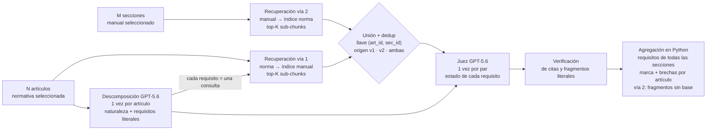

# 09 · Motor de doble vía



## 1. Recuperación de candidatos
```python
K_SUBCHUNKS  = 10    # vecinos por sub-chunk consultado      [CALIBRAR]
SIM_THRESHOLD = 0.30 # similitud coseno mínima               [CALIBRAR]
MIN_FLOOR    = 3     # siempre pasan al menos 3 secciones
MAX_CANDIDATES = 10  # tope de secciones candidatas por origen

def candidatos(seccion_origen, indice_destino) -> list[tuple[str, float]]:
    scores: dict[str, float] = {}
    for sc in subchunks(seccion_origen):
        D, I = indice_destino.search(sc.vec, K_SUBCHUNKS)
        for s, i in zip(D[0], I[0]):
            if i < 0: continue
            sec = indice_destino.mapa[i]
            scores[sec] = max(scores.get(sec, 0.0), float(s))   # colapso: mejor score por sección
    orden = sorted(scores.items(), key=lambda x: -x[1])
    sobre = [x for x in orden if x[1] >= SIM_THRESHOLD][:MAX_CANDIDATES]
    return sobre if len(sobre) >= MIN_FLOOR else orden[:MIN_FLOOR]
```
### 1b. Vía 1 consulta con cada requisito (decisión del usuario, 16 oct 2026, docs/14 #30)
Un artículo suele mezclar varios requisitos y su vector único los diluye. Por eso la **vía 1** no consulta con el artículo entero sino **con cada requisito obligatorio** que devuelve el paso 3a (§3a, que pasa a ejecutarse **antes** de la recuperación): `candidatos(requisito, indice_manual)` por requisito, y el candidato del artículo es la **unión** de las secciones de todos sus requisitos (mejor score por sección). `MAX_CANDIDATES` se aplica **por requisito**. Artículos `informativo` o `no_aplica_entidad`: sin requisitos, sin consulta. La **vía 2** no cambia (la sección del manual consulta el índice de la norma).
- **Evidencia** (`qa/eval-golden-requisitos.md`, prototipo `scripts/prototipo_descomposicion.py`, Groq `openai/gpt-oss-120b`, golden de 31 artículos y 71 pares, embeddings bge-m3, sin umbral): recall@candidatos de los pares **59,2 %** con el artículo entero (10 candidatos por artículo), **76,1 %** con el artículo entero y 21 candidatos (control de igual tamaño) y **87,3 %** con los requisitos del LLM (20,7 candidatos por artículo). Con anclas ideales del golden: 76 %.
- **Límites conocidos:** 88 % de los fragmentos del LLM son literales (≥ 0,90); los demás se verifican y corrigen o quedan `requiere_revision` (§3a). 93 % de las anclas del golden las toca algún requisito del LLM. Un solo modelo, un solo documento, 31 artículos: se repite con el golden completo (31 `por_confirmar` pendientes) antes de dar el criterio por cumplido.
- Si el paso 3a falla o devuelve un artículo `obligacion` sin requisitos, el artículo **vuelve a consultar con el texto entero** y queda `requiere_revision` (nunca A, §3a).

El **piso** garantiza que ninguna sección desaparezca: si nada supera el umbral, el juez recibe los 3 mejores y declara explícitamente "sin cobertura".

## 2. Pares únicos (deduplicación) — decisión clave de costo
Problema: si el Art. 5 recupera la sección 3.2 y la 3.2 recupera el Art. 5, ingenuamente se juzga dos veces (doble costo y posibles veredictos contradictorios).

Solución: la recuperación en ambas direcciones **solo construye candidatos**; luego se unen, se deduplican por `(articulo_id, seccion_id)` y **cada par se juzga exactamente una vez**.

```python
pares: dict[tuple[str, str], Par] = {}
for art in articulos_sel:                                   # vía 1
    for sec, s in candidatos(art, idx_manual):
        p = pares.setdefault((art.id, sec), Par(art.id, sec))
        p.score_v1, p.rank_v1 = s, rank; p.origen.add("v1")
for sec in secciones_sel:                                   # vía 2
    for art, s in candidatos(sec, idx_norma):
        p = pares.setdefault((art, sec.id), Par(art, sec.id))
        p.score_v2, p.rank_v2 = s, rank; p.origen.add("v2")
# p.score_max = max(score_v1, score_v2)
# log: n_pares_ingenuo vs n_pares_unicos
```
Las vías reaparecen **solo al reportar**: vía 1 = agrupar pares por artículo; vía 2 = agrupar los mismos pares por sección. Mismo veredicto, dos vistas, sin reconciliación. 50 × 40 secciones: ~900 juicios ingenuos → típicamente la mitad o menos.

## 3. Juez auditor normativo
Dos pasos con el LLM; todo lo demás es Python (decisión del usuario, 15 oct 2026, docs/14 #28). El objetivo es que el auditor vea **qué parte exacta** del artículo no está cubierta por el manual.

### 3a. Descomposición del artículo en requisitos (1 llamada por artículo seleccionado, **antes de la recuperación**, §1b)
- Prompt: `backend/prompts/requisitos.md` (prototipo en la rama `test/golden-requisitos-arlaft`). Entrada: texto literal completo del artículo + ruta + documento.
- Salida: la **naturaleza** del artículo (se decide aquí, una sola vez, y no por mayoría entre pares) y su lista de **requisitos atómicos**: cada uno con un id (`R1`, `R2`…; **Python renumera R1…Rn por orden de aparición** e ignora los ids del modelo), su **fragmento literal** del artículo y si es **obligatorio** (deber, prohibición, plazo, condición) o enunciativo (definición, finalidad, remisión).
- Un literal a), b)… es al menos un requisito (sustituye a `elementos_faltantes` como texto libre, docs/14 #6).
- Artículos `informativo` o `no_aplica_entidad`: sin requisitos; no pasan por el paso 3b (ahorra llamadas).
- **Controles deterministas de la descomposición** (appsec, 15 oct 2026): (a) si el texto del artículo que no cae en ningún fragmento supera `MAX_TEXTO_SIN_REQUISITO` caracteres no blancos, el artículo queda `requiere_revision`; (b) cada literal a), b)… detectado por regex debe tocar al menos un requisito; (c) como máximo `MAX_REQUISITOS` requisitos; (d) caché del paso 3a por SHA-256 del texto del artículo.
- Un artículo `obligacion` **debe** traer al menos un requisito obligatorio: si viene vacío o todos enunciativos, 1 reintento del paso 3a; si persiste, el artículo sale **R con `requiere_revision`** y **nunca** A (decisión del usuario, 15 oct 2026).

### 3b. Juicio por par (1 vez por par, como antes)
- Prompt: [`backend/prompts/juez.md`](../backend/prompts/juez.md).
- Entrada por par: texto literal **completo** del artículo y de la sección del manual + **la lista de requisitos del artículo** (3a) + rutas jerárquicas + nombres de documento.
- La lista de requisitos entra al prompt **delimitada** (`<requisitos>`, con `rellenar_prompt`) y con el **fragmento verificado**, no con el texto crudo del modelo.
- Para **cada requisito**: `cubierto`, `parcial` o `no_cubierto` **por esta sección**, la cita literal del manual que lo respalda y, si no está cubierto del todo, qué falta.
- Vía 2: los **fragmentos literales de la sección** que no responden a ningún requisito de este artículo.
- Concurrencia `asyncio` con semáforo `LLM_CONCURRENCY` (6). Progreso: "Par 128 de 412".

```python
class Requisito(BaseModel):                 # paso 3a, uno por requisito atómico del artículo
    id: str                                 # "R1", "R2"… estable dentro del artículo
    fragmento: str                          # literal del artículo (se verifica como una cita)
    obligatorio: bool                       # deber/prohibición/plazo/condición; False = enunciativo

class Descomposicion(BaseModel):            # paso 3a, una por artículo
    naturaleza_articulo: Literal["obligacion", "informativo", "no_aplica_entidad"]
    requisitos: list[Requisito] = []        # obligatorio (no vacío) si naturaleza == "obligacion": se valida en el modelo Pydantic

class EstadoRequisito(BaseModel):           # paso 3b, uno por requisito y par
    requisito_id: str
    estado: Literal["cubierto", "parcial", "no_cubierto"]
    cita_manual: str | None = None          # literal de la sección que lo respalda (si cubierto o parcial)
    cita_verificada: bool = False           # la rellena la verificación (§4): ratio >= CITATION_FUZZY_MIN
    falta: str | None = None                # qué le falta (si parcial o no_cubierto); texto del juez, no del documento

class Veredicto(BaseModel):                 # paso 3b, uno por par
    requisitos: list[EstadoRequisito]       # todos los requisitos del artículo, sin omitir ninguno
    fragmentos_sin_base: list[str] = []     # vía 2: literales de la sección que no responden a ningún requisito de este artículo (máx. MAX_FRAGMENTOS_SIN_BASE)
    comentario: str                         # todos los textos libres (falta, comentario) con max_length en Pydantic
    confianza: float = Field(ge=0, le=1)

class Par(BaseModel):
    id: str
    articulo_id: str
    seccion_id: str
    origen: set[Literal["v1", "v2"]]
    score_v1: float | None = None; rank_v1: int | None = None
    score_v2: float | None = None; rank_v2: int | None = None
    veredicto: Veredicto | None = None
    cita_norma_verificada: bool = False
    cita_manual_verificada: bool = False
    requiere_revision: bool = False
```

## 4. Validación de la respuesta
1. Validar con Pydantic. JSON inválido → 1 reintento con el error adjunto → si persiste: `requiere_revision=True`, listado en el anexo.
2. **Verificación de citas** (cada cita contra su texto fuente):
   - normalizar espacios y saltos de línea; comprobar subcadena exacta → verificada.
   - si no: buscar el fragmento más parecido con `difflib.SequenceMatcher` sobre ventanas del texto fuente; si ratio ≥ `CITATION_FUZZY_MIN` (0.90) → **reemplazar por el fragmento real** y marcar verificada.
   - si no y ratio ≥ `CITATION_SHOW_MIN` (0.75): `cita_*_verificada=False`, `requiere_revision=True`; el papel muestra el fragmento real más cercano con aviso.
   - si ratio < 0.75: `cita_*_verificada=False`, `requiere_revision=True`; celda vacía con aviso.
3. El texto fuente se **sanea una sola vez** (caracteres ilegales de Excel) antes de verificar; la búsqueda difusa solo corre si falla la exacta. Se verifican así: el `fragmento` de cada requisito (contra el artículo), cada `cita_manual` y cada `fragmentos_sin_base` (contra la sección). La verificación además guarda la **posición** (inicio y fin) del fragmento en el texto literal: con ella se pinta el Excel.
4. Un fragmento que no se verifica **no se pinta** (ni rojo ni nada) y el par o el artículo queda `requiere_revision=True`; el texto completo sigue en la celda.
   - **Un estado `cubierto` o `parcial` solo cuenta si su `cita_manual` está verificada** (≥ `CITATION_FUZZY_MIN`, 0,90). Si no, para la marca y el rojo se trata como `no_cubierto` y el par queda `requiere_revision` (decisión del usuario, 15 oct 2026: estricto ante inyección o alucinación, aunque pueda bajar la marca por una paráfrasis legítima).
5. Si la lista de requisitos de un par no trae todos los ids de 3a, trae ids que no existen o **repite un id** (aunque sea con otro estado): 1 reintento; si persiste, `requiere_revision=True`: los faltantes cuentan como `no_cubierto` y ante un id repetido gana el **peor** estado. Un par sin veredicto válido **no** se convierte en "no cubierto" en silencio: el artículo queda `requiere_revision`.
   - Un fragmento **vacío** nunca cuenta como verificado, y la posición guardada cumple `texto[ini:fin] == fragmento_real`.
   - Si el fragmento aparece **varias veces**, se toma la ocurrencia que empieza después del fragmento del requisito anterior (los requisitos siguen el orden del artículo); si aun así es ambiguo, la primera, con aviso.
   - Fragmentos que se **solapan** se pintan unidos, sin duplicar texto.
   - Las posiciones se calculan sobre el `texto_literal`; al escribir la celda (ruta antepuesta, caracteres ilegales quitados, truncado) se **trasladan** a ese texto, y la concatenación de los tramos del texto enriquecido es idéntica al texto saneado de la celda.
6. El texto que llega al Excel **siempre** proviene del documento fuente, nunca del modelo; el resaltado lo decide Python con las posiciones verificadas.

## 5. Agregación de marcas y brechas (Python, sin tokens)
Marcas del banco: **A** sí cumple · **L** parcialmente · **R** no cumple · **X** no aplica · **P** información obtenida de la normativa.
La marca es propiedad del **artículo** (fila del papel) y se deriva de **sus requisitos combinando todas las secciones juzgadas** (decisión del usuario, 15 oct 2026: varias secciones del manual pueden respaldar un mismo artículo; reemplaza docs/14 #5).

```python
ORDEN = {"cubierto": 2, "parcial": 1, "no_cubierto": 0}

def estado_requisitos(desc: Descomposicion, pares: list[Par]) -> dict[str, tuple[str, list[Par]]]:
    """Por requisito: el mejor estado entre todas las secciones y los pares que lo respaldan (cubierto o parcial)."""
    out = {}
    for r in desc.requisitos:
        estados = [(e, p) for p in pares if p.veredicto for e in p.veredicto.requisitos
                   if e.requisito_id == r.id and (e.estado == "no_cubierto" or e.cita_verificada)]   # sin cita verificada = no cubierto
        mejor = max((e.estado for e, _ in estados), key=ORDEN.get, default="no_cubierto")
        out[r.id] = (mejor, [p for e, p in estados if e.estado != "no_cubierto"])
    return out

def marca_articulo(desc, pares) -> tuple[str, list[Requisito]]:
    if desc.naturaleza_articulo == "informativo":       return "P", []
    if desc.naturaleza_articulo == "no_aplica_entidad": return "X", []
    est = estado_requisitos(desc, pares)
    oblig = [r for r in desc.requisitos if r.obligatorio]
    brechas = [r for r in oblig if est[r.id][0] != "cubierto"]      # se pintan en rojo (docs/10)
    if not oblig:                                                    return "R", []   # + requiere_revision (§3a): nunca A sin requisitos
    if not brechas:                                                  return "A", []
    if any(est[r.id][0] != "no_cubierto" for r in oblig):            return "L", brechas
    return "R", brechas                                              # R: solo los requisitos obligatorios van en rojo

# `secciones_sel` son solo las secciones INCLUIDAS (las excluidas como no comparables no son controles sin base: van aparte, con su motivo, en el anexo).
def controles_sin_base(secciones_sel, pares) -> dict[str, list[tuple[int, int]]]:
    # Vía 2, por sección:
    # - sin ningún par con algún requisito cubierto o parcial de un artículo "obligacion" -> la sección entera es control sin base;
    # - si no, los tramos (posiciones verificadas) que aparecen en `fragmentos_sin_base` en TODOS los pares de la sección con
    #   artículos "obligacion" (intersección, por rangos de caracteres verificados): ningún artículo juzgado los respalda.
    #   A la intersección se le restan los tramos usados como `cita_manual` verificada en cualquier par.
    #   Se pintan en rojo en el bloque vía 2. Un par sin veredicto válido no entra en la intersección y la sección queda en revisión.
    #   Limitación: un solo par que devuelva [] vacía los fragmentos sin base de la sección (qa-ia mide el recall de la vía 2).
```

- **Varias secciones, un artículo:** un requisito está cubierto si **alguna** sección lo cubre. El respaldo del artículo son **todas** las secciones que cubren o cubren parcialmente algún requisito, no una sola.
- **Lo que se resalta es solo la brecha:** el texto de los requisitos obligatorios no cubiertos o cubiertos parcialmente. Lo cubierto **no se resalta**: marcar algo como "cumple" equivale a aprobarlo, y aprobar el control es responsabilidad del dueño del manual y del proceso, no de auditoría (usuario, 15 oct 2026).
- **Criterio conservador (decidido por el usuario, 15 oct 2026):** dos coberturas parciales del **mismo** requisito en secciones distintas no suman una total: el requisito queda `parcial`, se pinta **entero** en rojo igual que uno no cubierto, y el juez explica qué falta en cada una. En L, como en R, solo se pintan los requisitos **obligatorios**.
- **Costo y topes (LLM10):** +1 llamada por artículo (paso 3a, con caché) y una salida más larga por par. Topes en configuración (`[CALIBRAR]`): `MAX_REQUISITOS` (~25), `MAX_FRAGMENTOS_SIN_BASE` (~10), `MAX_TEXTO_SIN_REQUISITO`, `LLM_MAX_TOKENS` por llamada. Se mide contra RNF-11 en la Raspberry. **Si se excede el presupuesto de tiempo o costo** (decisión del usuario, 15 oct 2026): los artículos o pares sin resolver quedan **vacíos** (sin marca, con `requiere_revision`) y se retoman en una **segunda pasada solo con los pendientes**, solo si los hubiera; nunca se recorta texto ni se baja la calidad para ganar tiempo.

